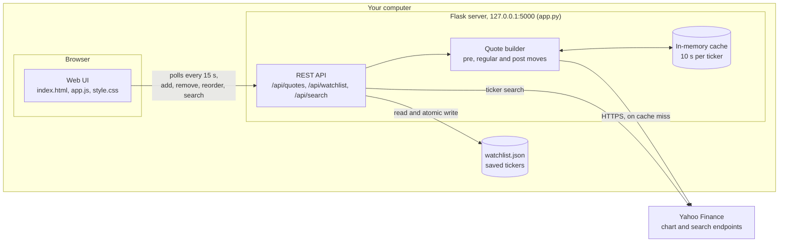

# Aurora Watch

A local stock watchlist that shows pre-market, regular and after-hours quotes.

Want an even simpler Windows version? see: https://github.com/dtomyn/AuroraWatchLite

https://github.com/user-attachments/assets/fc4f0571-cc68-4cb2-9a3d-755d3ec829fb

```bash
python -m venv .venv
.venv/Scripts/python -m pip install -r requirements.txt
.venv/Scripts/python app.py
```

Open http://127.0.0.1:5000. Add and remove tickers in the app; they are saved to `watchlist.json` as you go.
Set `WATCHLIST_FILE` or `PORT` to change the config path or port.

Quotes come from Yahoo Finance's public chart endpoint, which is unofficial and may be delayed.

## Dev container

With Docker and the VS Code Dev Containers extension installed, run **Dev Containers: Reopen in Container**, then:

```bash
python app.py
```

VS Code forwards port 5000 to http://localhost:5000. To re-record the demo video in the container, run `python docs/demo/record_demo.py`.

## Architecture



See the [product requirements](docs/PRD.md) and [technical specification](docs/SPECIFICATION.md) for details.
